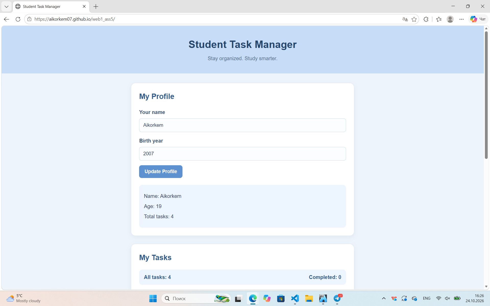
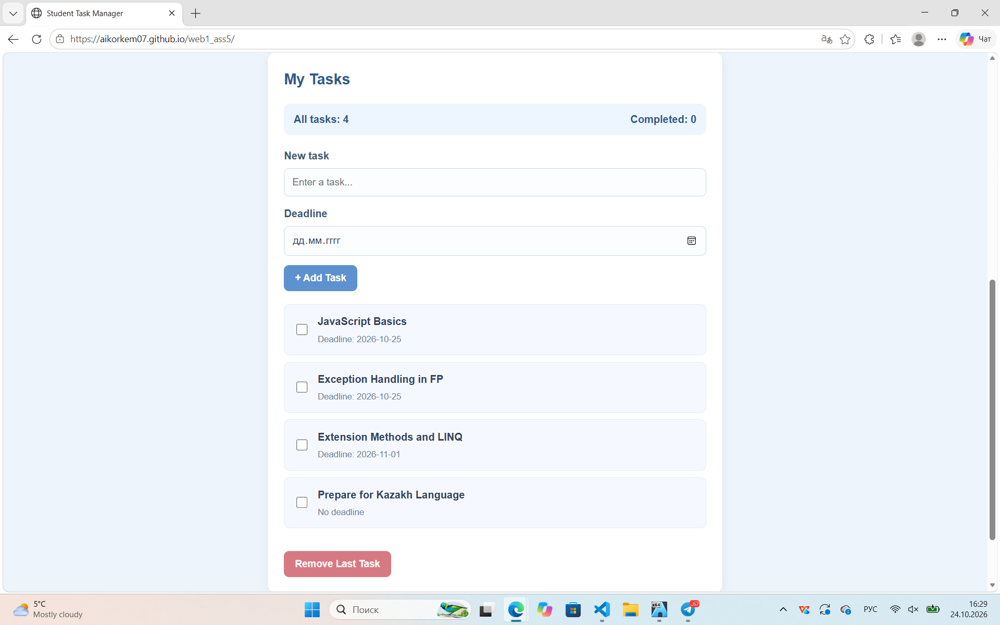
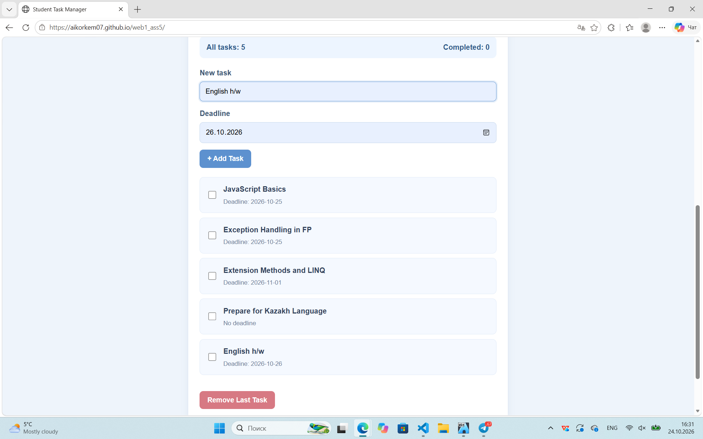
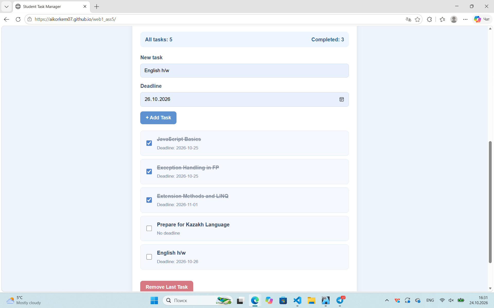
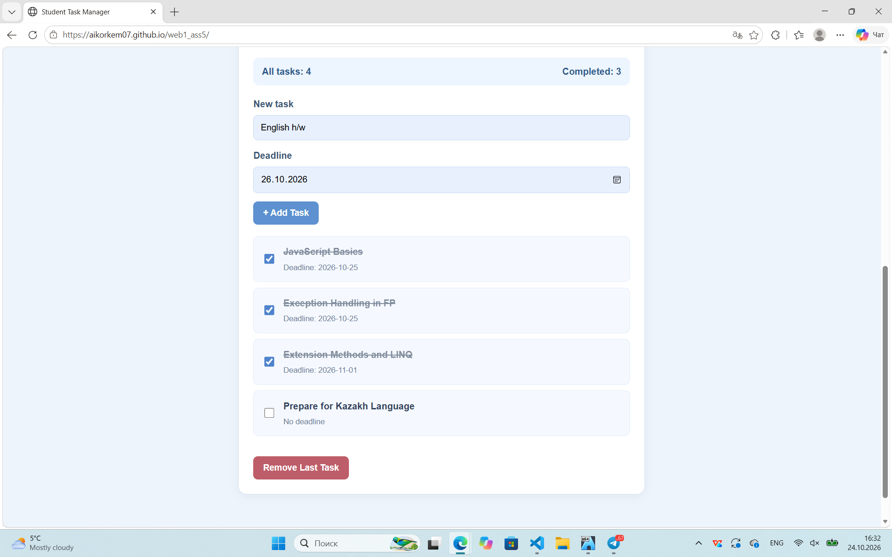
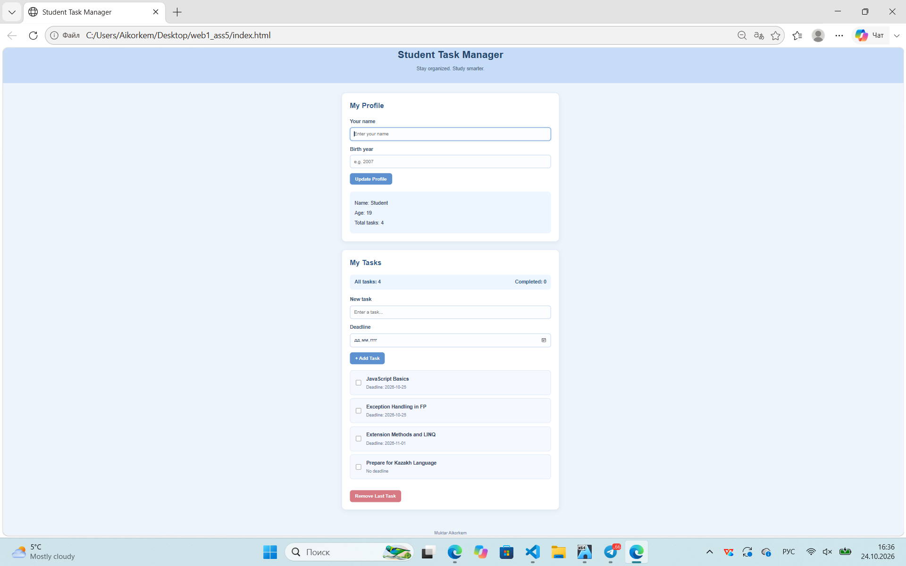

Assignment #5: JavaScript Basics

Name: Aikorkem Muktar

Group: IT-2513

Project Description

Student Task Manager is a website that helps students organize their university assignments. It was created using HTML, CSS, and JavaScript.

Part 1: Profile Object, Data Types and Arithmetic

I created a userProfile object with a name, birth year, developer status, and hobbies. I used string, number, boolean, and array data types. I also created a function to calculate age and used the length property to count hobbies.

Part 2: Form Input and Events

I created a form where users can enter their name and birth year. The Update Profile button updates the profile information. I used a submit event listener to get the input values and update the object. I also added input validation.

Part 3: DOM List Manipulation

I created a task list containing university assignments. Users can add new tasks, set deadlines, remove the last task, and mark tasks as completed. I used createElement(), appendChild(), push(), and pop() to manage the list.

The website also displays the total number of tasks and completed tasks. The counters update automatically when the list changes.

Design and Responsiveness

I used CSS to create a simple blue design with white cards, blue buttons, and dark blue text. I added hover effects and a media query to make the website responsive on smaller screens.

Testing

I tested the profile form, age calculation, task addition, task removal, completion checkboxes, and task counters. These features worked correctly during testing.

Work Process

First, I created the HTML structure. Then, I styled the website using CSS. Finally, I added JavaScript functions and tested the main features.

Project Links

GitHub Repository:https://github.com/Aikorkem07/web1_ass5.git

GitHub Pages:https://aikorkem07.github.io/web1_ass5/

Conclusion

In this assignment, I learned how to work with JavaScript objects, data types, arithmetic operators, event listeners, forms, and DOM manipulation. I also learned how to create an interactive task manager.
